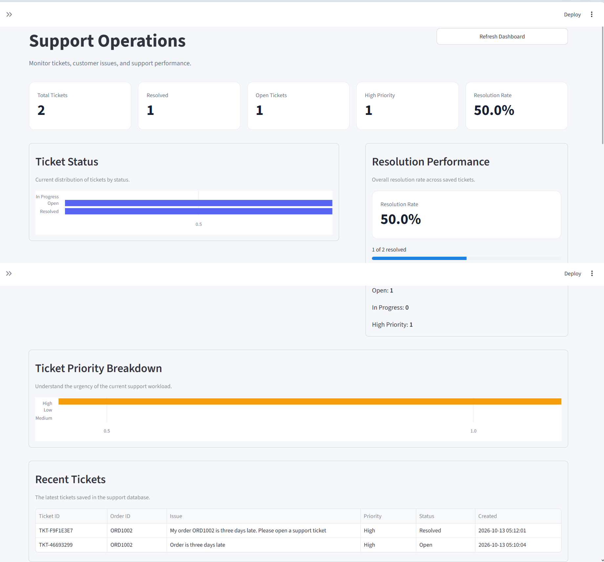

# Agentic AI Customer Support & Resolution System

An AI-powered customer support dashboard designed to help support teams analyze customer queries, retrieve relevant policies, manage support tickets, and evaluate AI-generated responses.

The project combines a local large language model (LLM), policy-based retrieval, support tools, Model Context Protocol (MCP) integration, evaluation workflows, structured logging, and analytics in an interactive Streamlit dashboard.

## Key Features

- **AI Support Chat:** Generate responses to customer support queries using a local LLM.
- **Policy Retrieval:** Retrieve relevant information from the project's customer support knowledge base.
- **Intent Detection:** Identify the likely intent behind customer queries.
- **Order Lookup:** Retrieve order information from local demonstration data.
- **Ticket Management:** Create and manage support tickets while reducing duplicate ticket creation.
- **MCP Integration:** Connect an AI agent to support tools through the Model Context Protocol.
- **Tool-Calling Safety:** Validate tool names and arguments before executing supported operations.
- **Refund Safety:** Distinguish refund eligibility from refund approval or actual refund processing.
- **AI Response Evaluation:** Evaluate agent responses against predefined test cases.
- **Automated Evaluation:** Run the full pytest suite and generate a machine-readable JSON report.
- **Structured Logging:** Record supported application events with safeguards for sensitive fields.
- **Audit Logging:** Maintain records of supported application activities for traceability.
- **Evaluation History:** Store and review previous evaluation results.
- **Performance Analytics:** View dashboard metrics related to support tickets and evaluation results.
- **Automated Testing:** Run regression tests locally and through GitHub Actions.

## Dashboard Pages

The application includes six dashboard pages:

1. **Overview** — View key support metrics.

   

2. **Ticket Management** — Review and manage support tickets.
3. **Audit Log** — Inspect recorded application activities.
4. **AI Support Chat** — Interact with the AI support assistant.
5. **AI Evaluation** — Run response evaluations against a test dataset.
6. **Performance Analytics** — Review support and evaluation performance.

## Technology Stack

- **Python** — Application logic and agent workflows.
- **Streamlit** — Interactive dashboard.
- **Ollama** — Run a local language model.
- **Llama 3.2 (3B)** — Local model used for response generation.
- **Model Context Protocol (MCP)** — Standardized communication between the agent and supported tools.
- **JSON / JSONL** — Local application and evaluation data storage.
- **Pytest** — Automated testing.
- **GitHub Actions** — Continuous integration.
- **PowerShell** — Development and execution environment on Windows.

## Architecture

```text
Customer Query
      |
      v
Streamlit Dashboard
      |
      v
Intent Detection
      |
      v
Support Agent
      |
      +--------------------------+
      |                          |
      v                          v
Policy Knowledge Base       Support Tools
      |                     - Order Lookup
      |                     - Ticket Management
      |                     - Audit Logging
      |                          |
      +------------+-------------+
                   |
                   v
          Local LLM via Ollama
                   |
                   v
        Generated Support Response
                   |
                   v
          Evaluation and Analytics
```

### MCP Tool Integration

The project also includes an MCP server and agent clients for connecting supported tools through the Model Context Protocol.

```text
LLM-Driven Agent
       |
       v
MCP Client
       |
       v
MCP Server
       |
       +--------------------+
       |                    |
       v                    v
   Order Lookup       Ticket Management
                            |
                            v
                       Audit Logging
```

The MCP integration is intended for controlled tool access. Tool requests should be validated, and uncertain outcomes from timed-out operations should not automatically trigger repeated state-changing actions.

## Project Structure

```text
agentic-customer-support/
├── .github/
│   └── workflows/
│       └── tests.yml
├── app/
│   ├── agents/
│   │   ├── intent_detector.py
│   │   └── support_agent.py
│   ├── core/
│   │   └── config.py
│   ├── evaluation/
│   │   ├── evaluator.py
│   │   └── history.py
│   ├── rag/
│   │   └── knowledge_base.py
│   ├── tools/
│   │   ├── audit_log.py
│   │   ├── order_tools.py
│   │   └── ticket_tools.py
│   ├── agent_logging.py
│   ├── automated_evaluation.py
│   ├── dashboard_metrics.py
│   ├── evaluate_agent.py
│   ├── main.py
│   └── monitoring.py
├── assets/
├── data/
│   ├── database/
│   ├── evaluation/
│   │   └── test_cases.json
│   └── knowledge_base/
│       ├── delivery_policy.txt
│       └── refund_policy.txt
├── tests/
├── mcp_agent.py
├── mcp_agent_llm.py
├── mcp_server.py
├── requirements.txt
├── README.md
└── LICENSE
```

Additional root-level test modules cover tool behavior, MCP integration, and safe multi-tool dispatch. Runtime files and generated evaluation reports may be created locally and are not necessarily included in the repository.

## Getting Started

### Prerequisites

- Python 3.11 or later.
- Git.
- Ollama installed and running.
- The `llama3.2:3b` model downloaded locally.
- Windows PowerShell commands are used in the examples below.

### 1. Clone the repository

```powershell
git clone https://github.com/manojreddy2997/Agentic-AI-Customer-Support-Resolution-System.git
cd Agentic-AI-Customer-Support-Resolution-System
```

### 2. Create a virtual environment

```powershell
python -m venv .venv
```

### 3. Activate the virtual environment

```powershell
.\.venv\Scripts\Activate.ps1
```

If PowerShell blocks activation, consult the official Python documentation for your environment's execution policy. You can also run the virtual environment's Python executable directly.

### 4. Install dependencies

```powershell
python -m pip install --upgrade pip
python -m pip install -r requirements.txt
```

### 5. Install and start Ollama

Install Ollama from its official website:

https://ollama.com/

Download the model:

```powershell
ollama pull llama3.2:3b
```

Verify that the model is available:

```powershell
ollama list
```

Make sure the Ollama service is running before starting an application workflow that requires the model.

### 6. Start the dashboard

From the project root, run:

```powershell
python -m streamlit run app/main.py
```

Open the local URL displayed in the terminal, usually:

```text
http://localhost:8501
```

### 7. Run the MCP agent

The repository contains MCP-related scripts for interacting with supported tools. The LLM-driven MCP agent can be started from the project root with:

```powershell
python mcp_agent_llm.py
```

Make sure Ollama is running and the configured model is available. The MCP client must also be able to launch or connect to the MCP server as configured by the project.

The dashboard, MCP agent, and MCP server may have different entry points and requirements; use the appropriate script for the workflow you want to demonstrate.

## Running Tests

Run the full automated test suite from the project root:

```powershell
python -m pytest -q
```

The latest verified local run completed with **103 passing tests**. Test counts may change as the project evolves.

Tests cover supported application behavior, tool validation, MCP integration, logging safeguards, and other regression scenarios.

## Automated Evaluation

Run the automated evaluation script:

```powershell
python -m app.automated_evaluation
```

The script runs the full pytest suite and writes a machine-readable report to:

```text
automated_evaluation_report.json
```

The report records:

- Evaluation timestamp.
- Test command.
- Process exit code.
- Pass/fail status.
- Test summary.
- Detailed pytest output.

The generated report is a local runtime artifact and is excluded from version control.

A passing test suite is useful evidence of regression coverage, but it does not guarantee that every possible real-world scenario is safe or correct.

## Continuous Integration

GitHub Actions runs the full pytest suite when changes are pushed to the repository or submitted through a pull request.

The workflow is defined in:

```text
.github/workflows/tests.yml
```

The workflow installs the declared dependencies and executes:

```powershell
python -m pytest -q
```

View workflow results here:

https://github.com/manojreddy2997/Agentic-AI-Customer-Support-Resolution-System/actions

## Safety and Reliability

The project includes safeguards intended to improve the reliability of AI-assisted support operations:

- Validate tool names and arguments before supported operations are executed.
- Avoid creating duplicate tickets when an existing active ticket can be reused.
- Distinguish refund eligibility from refund approval or completed refund processing.
- Avoid reporting a state-changing operation as successful unless success is confirmed.
- Treat timeouts during state-changing operations as potentially uncertain outcomes.
- Avoid blindly retrying a mutation when its previous outcome is unknown.
- Redact recognized sensitive fields from structured logs.

These safeguards reduce certain risks but do not eliminate hallucinations, incorrect tool decisions, or all forms of sensitive-data exposure. The system should be tested and reviewed before use in any consequential customer-support environment.

## Current Limitations

- The application is a portfolio and demonstration project, not a production customer-support platform.
- Order and ticket operations use local demonstration data rather than a live business system.
- Policy retrieval uses the project's policy knowledge base; it should not be described as embedding-based or vector-database RAG.
- The application does not perform real payments, issue actual refunds, or automatically connect to external customer-service platforms.
- Generated answers should be reviewed before being used for real customer decisions.
- Ticket and audit data are stored locally, so a fresh installation may not contain existing tickets or history.
- Local model performance depends on available hardware, model configuration, and prompt quality.
- Authentication, authorization, and production-grade deployment controls are not established by the existence of automated tests alone.

## Future Improvements

- Improve policy retrieval and evaluate retrieval relevance across a broader test dataset.
- Expand response-quality evaluation and monitoring.
- Add authenticated users and role-based access controls.
- Integrate approved external customer-support systems.
- Expand regression tests for tool failures, audit logging, and safety scenarios.
- Test multiple supported Python versions in continuous integration.
- Add more comprehensive end-to-end tests for the dashboard and MCP workflows.
- Improve operational documentation, deployment guidance, and configuration management.

## License

This project is licensed under the MIT License. See [LICENSE](LICENSE) for details.

---

**Built as a hands-on project exploring agentic AI, local LLMs, MCP tool integration, customer-support automation, evaluation, and analytics.**
