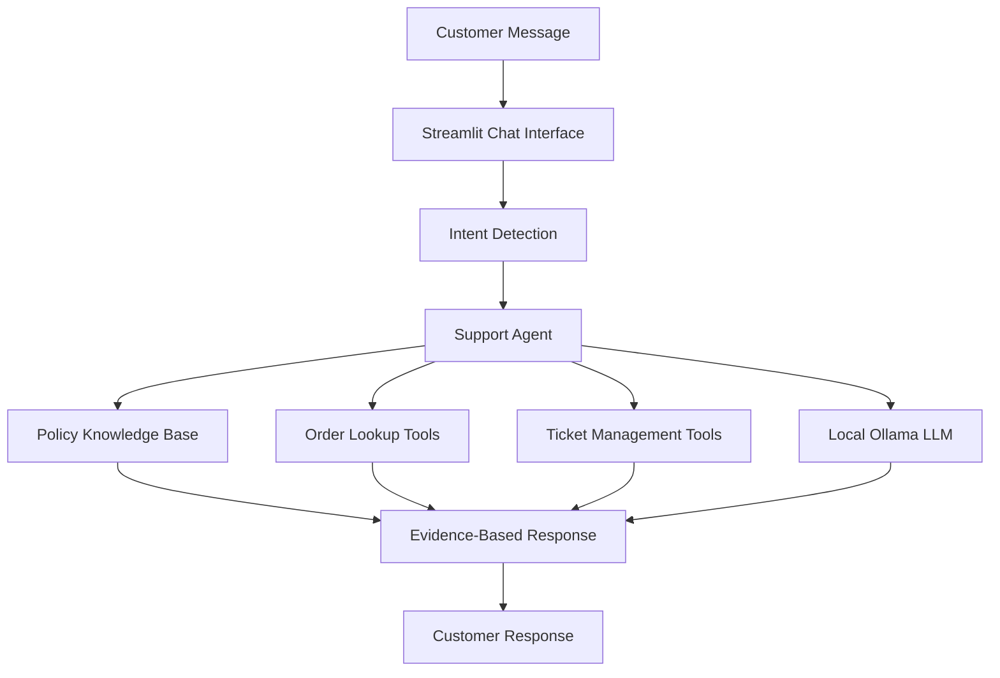

# 🤖 Agentic AI Customer Support & Resolution System

An AI-powered customer support assistant that understands customer requests, retrieves relevant policy information, looks up orders, and manages support tickets using a local LLM and Python-based tools.

Built as a hands-on AI engineering portfolio project, this system demonstrates agent-style orchestration, policy-grounded responses, tool usage, and automated testing.

## ✨ Key Features

- **Customer Intent Detection** — Identifies the intent behind customer messages.
- **Policy-Grounded Responses** — Searches local refund and delivery policy documents to provide relevant answers.
- **Order Tracking** — Looks up sample order records and reports their delivery status.
- **Support Ticket Management** — Creates tickets for supported issues and reuses existing active tickets when applicable.
- **Local LLM Integration** — Uses Ollama with Llama 3.2 (3B) for local language-model inference.
- **Action Safeguards** — Avoids claiming that refunds have been approved or processed without evidence.
- **Persistent Demo Data** — Stores sample order and support-ticket information in JSON files.
- **Automated Testing** — Includes a pytest suite for intent detection and support-agent behavior.

## 🏗️ System Architecture



The support agent coordinates the available components to answer customer questions and handle supported workflows. Policy retrieval currently uses local document search rather than embedding-based vector retrieval.

## 🛠️ Technology Stack

| Technology | Purpose |
|---|---|
| Python | Application logic |
| Streamlit | Interactive web interface |
| Ollama | Local LLM runtime |
| Llama 3.2 (3B) | Language-model inference |
| Local policy files | Refund and delivery policy knowledge |
| JSON | Sample orders and ticket storage |
| Pytest | Automated testing |
| Git & GitHub | Version control and project hosting |

## 📂 Project Structure

```text
agentic-customer-support/
├── app/
│   ├── agents/
│   │   ├── intent_detector.py
│   │   └── support_agent.py
│   ├── core/
│   │   └── config.py
│   ├── rag/
│   │   └── knowledge_base.py
│   ├── tools/
│   │   ├── order_tools.py
│   │   └── ticket_tools.py
│   └── main.py
├── data/
│   ├── database/
│   │   └── support_tickets.json
│   └── knowledge_base/
│       ├── delivery_policy.txt
│       └── refund_policy.txt
├── tests/
│   ├── test_intent_detector.py
│   └── test_support_agent.py
├── .gitignore
├── LICENSE
├── README.md
└── requirements.txt
```

## 🚀 Getting Started on Windows

### Prerequisites

- Python 3.11 or a compatible version
- Git
- [Ollama](https://ollama.com/download)
- Sufficient memory and disk space for the local model

### 1. Clone the repository

```powershell
git clone https://github.com/manojreddy2997/Agentic-AI-Customer-Support-Resolution-System.git
cd Agentic-AI-Customer-Support-Resolution-System
```

### 2. Create and activate a virtual environment

```powershell
python -m venv .venv
.\.venv\Scripts\Activate.ps1
```

### 3. Install Python dependencies

```powershell
python -m pip install -r requirements.txt
```

### 4. Download the local model

```powershell
ollama pull llama3.2:3b
```

Verify that the model is available:

```powershell
ollama list
```

Ensure the Ollama service is running before using the application.

### 5. Start the application

```powershell
python -m streamlit run app/main.py
```

Open the local URL displayed in the terminal, usually `http://localhost:8501`.

## 🧪 Testing

Run the automated test suite:

```powershell
python -m pytest -v
```

**Verified development result:** 34 tests passed in 1.39 seconds during a local test run.

The test suite covers intent detection and support-agent behavior. Manual workflow checks also confirmed refund-policy responses, order lookup for a delayed sample order, and reuse of an existing support ticket.

Test results can vary after code or dependency changes.

## 🔍 Example Workflows

### Refund policy

**Customer:** "What is your refund policy?"

The assistant consults the local refund policy and explains that eligibility does not mean a refund has been approved or processed.

### Order tracking

**Customer:** "Where is my order ORD1002?"

The assistant retrieves the sample order record and reports the product, delayed status, and expected delivery date.

### Support ticket management

**Customer:** "Please create a support ticket for my delayed order ORD1002."

The assistant can reuse an existing active ticket for the order rather than creating a duplicate.

These examples use fictional demonstration data, not a live commerce platform.

## 🔐 Privacy and Security

- The application is designed around local model inference using Ollama.
- Sample orders and tickets are stored locally in JSON files.
- No real customer records, passwords, API keys, or confidential business information should be committed to GitHub.
- Local inference does not by itself guarantee complete privacy; operating-system security, logs, and data handling still matter.
- The current project is a prototype and is not production-ready.

## ⚠️ Current Limitations

- Policy retrieval uses local keyword-based search, not semantic embeddings or a vector database.
- Order and ticket records are sample data, not connected to a real business system.
- Authentication, role-based access control, and production-grade database security are not implemented.
- The application does not process actual refunds or interact with live payment systems.
- Automated tests do not replace end-to-end testing, security review, or production monitoring.

## 🗺️ Roadmap

- [ ] Add semantic retrieval with embeddings and a vector database.
- [ ] Improve retrieval relevance and response-quality evaluation.
- [ ] Add human approval for sensitive customer-impacting actions.
- [ ] Integrate secure order-management and help-desk APIs.
- [ ] Add audit logs, authentication, and access controls.
- [ ] Build a deployment workflow with monitoring and error handling.

## 📄 License

This project is licensed under the [MIT License](LICENSE).

---

**Built as an AI engineering portfolio project** to explore agentic workflows, local LLMs, policy-grounded responses, tool orchestration, and automated testing.
